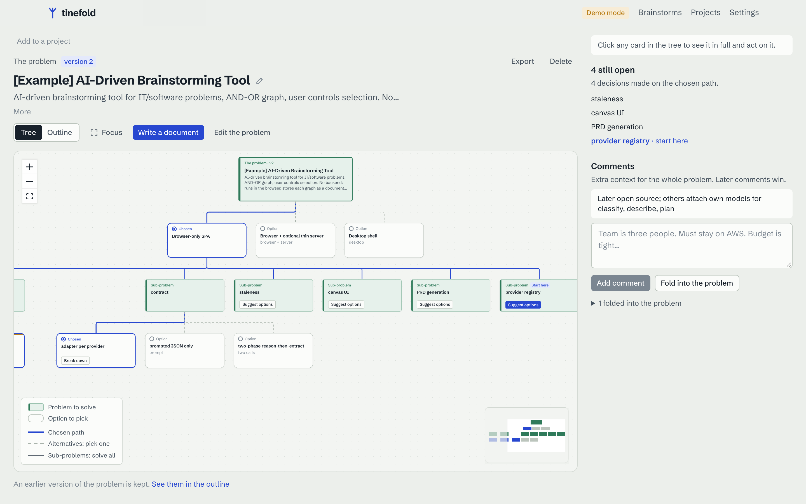
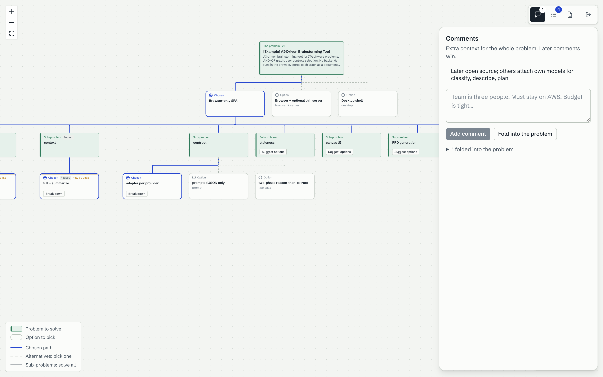
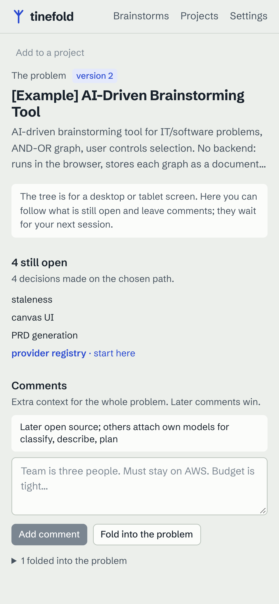
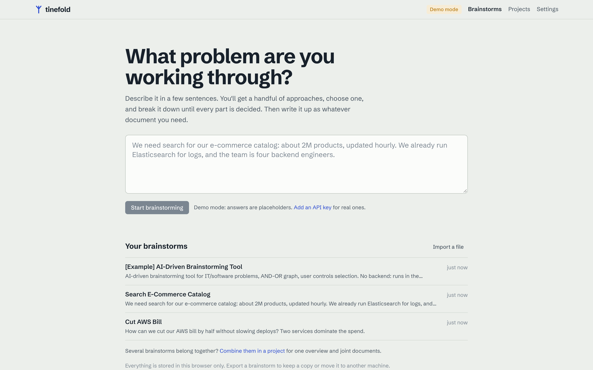
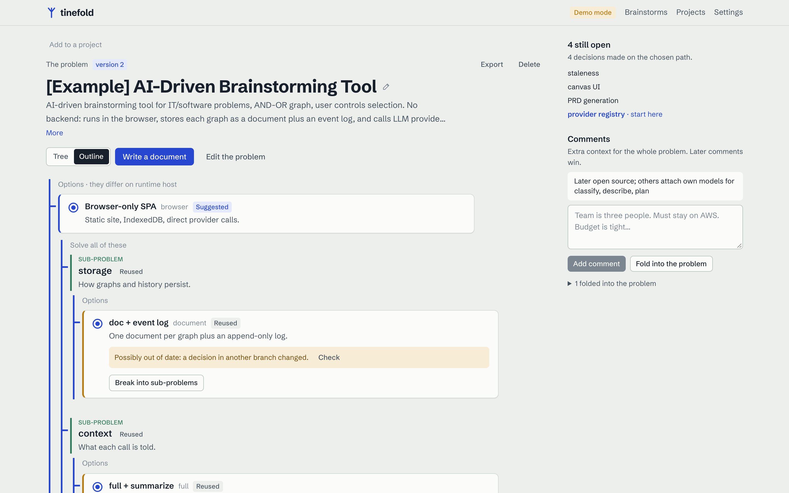
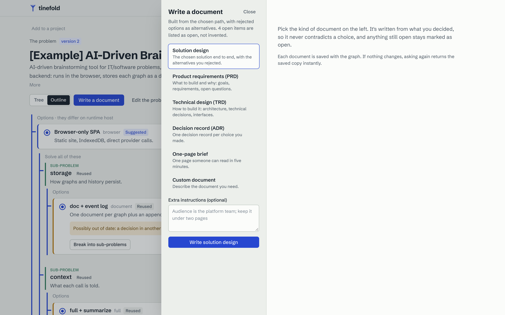

# tinefold

[](https://github.com/ravingupta/tinefold/actions/workflows/ci.yml)
[](LICENSE)

[](CONTRIBUTING.md)

**[Try the live demo →](https://ravingupta.github.io/tinefold/)** (demo mode, no key needed)

An AI brainstorming tool for software problems. You describe a problem; the AI proposes approaches; you choose
one; it breaks your choice into sub-problems; you keep choosing until everything is decided. Then it writes the
result up as the document you need: solution design, PRD, TRD, decision records or a one-page brief. Brainstorms
that belong together can be combined in a project for one high-level structure and documents written across all
of them.



Two kinds of card, so the tree reads at a glance: **green, square-cornered cards are problems** (solve all of
them), **white, rounded cards are options** (pick one). Blue is reserved for what you chose.

<table>
  <tr>
    <td colspan="2"></td>
    <td></td>
  </tr>
  <tr>
    <td colspan="2" align="center">Focus mode (<kbd>f</kbd>): only the tree, with comments, progress and documents one icon away</td>
    <td align="center">On a phone: follow progress and leave comments; the tree waits for a bigger screen</td>
  </tr>
  <tr>
    <td></td>
    <td></td>
    <td></td>
  </tr>
  <tr>
    <td align="center">Describe the problem; each brainstorm gets a short, editable name</td>
    <td align="center">Outline, with stale decisions flagged</td>
    <td align="center">Write it up</td>
  </tr>
</table>

## Why

AI chats are good at producing a plan, but they make every decision for you in one go, and a change of mind
means starting over. tinefold keeps **you** choosing at each step, remembers why each option was rejected,
marks decisions that may be out of date when the context changes, and only writes documents from what you
actually decided.

- **No backend.** It runs entirely in the browser. Brainstorms live in IndexedDB, and model calls go directly from
  your browser to the provider you choose (Anthropic or any OpenAI-compatible endpoint) with your own key.
- **Event-sourced.** Every brainstorm is an append-only event log, so history, export/import and "earlier
  versions of the problem" come for free.
- **Demo mode.** Without a key, a mock provider gives placeholder answers, so you can explore the whole flow.
- **Built for a big screen.** Deciding happens in the tree, on a desktop or tablet; focus mode strips away
  everything else. Phones get a read-only companion: progress and comments, never the tree.

## Repository layout

| Folder | What it is |
| --- | --- |
| [`tinefold-engine/`](tinefold-engine/) | The engine: event log, rules, staleness, prompts, providers, documents. Pure TypeScript, no DOM, fully tested. |
| [`tinefold-web/`](tinefold-web/) | The web app (React + Vite): renders the engine and forwards clicks. No graph logic. |
| [`docs/specs/`](docs/specs/) | The [PRD](docs/specs/prd-v0.md), [engine spec](docs/specs/engine-spec.md) and [web client spec](docs/specs/web-client-spec.md). Where the code differs, [`tinefold-engine/DECISIONS.md`](tinefold-engine/DECISIONS.md) says why. |

## Run it locally

Requires Node 20+.

```sh
git clone https://github.com/ravingupta/tinefold && cd tinefold
cd tinefold-web && npm install && npm run dev      # http://localhost:5173, engine from npm
cd ../tinefold-engine && npm install && npm test     # only if you work on the engine
```

It starts in demo mode. Open **Settings**, pick a provider and paste a key for real answers. Keys are stored in
your browser's localStorage and sent only to that provider.

Deploying your own copy: `npm run build` in `tinefold-web/`, then host `dist/` on any static host. Paths are
relative, so a subfolder works.

## Contributing

Issues and pull requests are welcome! Start with [CONTRIBUTING.md](CONTRIBUTING.md). Please follow the
[Code of Conduct](CODE_OF_CONDUCT.md), and report security issues privately as described in
[SECURITY.md](SECURITY.md).

## License

[MIT](LICENSE) © Ravin Gupta
